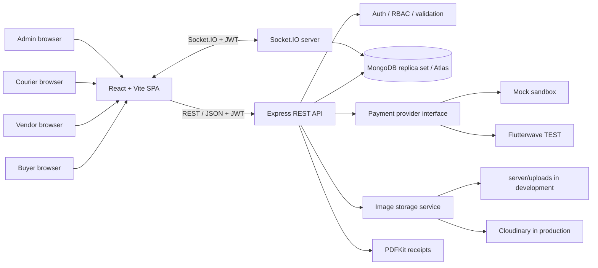

# DishDash

DishDash is a final-year-project MVP for on-demand Nigerian food delivery. It
combines a responsive React SPA with a stateless Express API, MongoDB/Mongoose
transactions, JWT/RBAC, sandbox payments, double-entry ledger, PDF receipts,
and Socket.IO delivery updates.

The project demonstrates the main marketplace roles and workflow end-to-end:
buyers order food; vendors manage menus and prepare orders; couriers deliver
them; admins audit transactions and resolve disputes. See
[the 10-minute demo script](./docs/DEMO-SCRIPT.md) and
[PRD traceability matrix](./docs/PRD-TRACEABILITY.md). For live deployment,
follow [the free-tier deployment guide](./docs/DEPLOYMENT.md).

## Architecture



## Database model

```mermaid
erDiagram
  USER ||--o{ PRODUCT : owns
  USER ||--o| CART : has
  CART }o--o{ PRODUCT : contains
  USER ||--o{ ORDER : buys
  USER ||--o{ ORDER : fulfills
  USER o|--o{ ORDER : delivers
  ORDER ||--|{ ORDER_ITEM : contains
  PRODUCT ||--o{ ORDER_ITEM : snapshot
  ORDER ||--o| PAYMENT : paid_by
  ORDER ||--o{ LEDGER_ENTRY : posts
  ORDER ||--o| RECEIPT : issues
  ORDER ||--o| DISPUTE : may_have
  PAYMENT ||--o{ WEBHOOK_EVENT : receives

  USER {
    ObjectId id PK
    string name
    string email UK
    string passwordHash
    string role
    boolean isActive
  }
  PRODUCT {
    ObjectId id PK
    ObjectId vendor FK
    string name
    int priceCents
    int stock
    string imageUrl
    string category
    boolean isActive
  }
  CART {
    ObjectId id PK
    ObjectId buyer FK UK
    array items
  }
  ORDER {
    ObjectId id PK
    ObjectId buyer FK
    ObjectId vendor FK
    ObjectId courier FK
    string status
    int totalCents
    string currency
    string idempotencyKey UK
  }
  ORDER_ITEM {
    ObjectId id PK
    ObjectId order FK
    ObjectId product FK
    int quantity
    int unitPriceCents
    int lineTotalCents
  }
  PAYMENT {
    ObjectId id PK
    ObjectId order FK UK
    string provider
    string providerReference UK
    int amountCents
    string status
  }
  LEDGER_ENTRY {
    ObjectId id PK
    ObjectId order FK
    string account
    string direction
    int amountCents
    string idempotencyKey UK
  }
  RECEIPT {
    ObjectId id PK
    ObjectId order FK UK
    string receiptNumber UK
    binary pdfData
  }
  DISPUTE {
    ObjectId id PK
    ObjectId order FK UK
    ObjectId buyer FK
    string reason
    string status
  }
  WEBHOOK_EVENT {
    ObjectId id PK
    string eventId UK
    string provider
    string type
  }
```

## Requirements

- Node.js 20 or later and npm
- MongoDB Atlas replica-set cluster (recommended for demo) or Docker Desktop for
  the optional local replica set
- Internet access on the first test run if `mongodb-memory-server` needs to
  fetch its MongoDB binary

Multi-document checkout/refund transactions require a replica set or sharded
MongoDB deployment. Docker is optional; the API reads `MONGODB_URI` from
`server/.env` and connects directly to Atlas.

## Setup

### MongoDB Atlas

1. Create an Atlas database user with read/write access.
2. Add your current public IP to **Network Access → IP Access List**.
3. Copy the replica-set connection string from Atlas. URL-encode special
   characters in the database password.

### Install and configure

From the repository root:

```powershell
npm.cmd run install-all
Copy-Item .env.example server/.env
Copy-Item client/.env.example client/.env
```

Edit `server/.env`; set `MONGODB_URI`, a unique random `JWT_SECRET` of at least
32 characters, and a separate `ADMIN_REGISTRATION_KEY`. For the default
offline local demo, keep `PAYMENT_PROVIDER=mock` and `DEMO_MODE=false` (simulation
is available in development). In `client/.env`, keep
`VITE_API_URL=http://localhost:4000/api` and `VITE_DEMO_MODE=false`. The server `CLIENT_ORIGIN` must list
the browser origin (normally `http://localhost:5173`).

Start both apps from the repository root:

```powershell
npm.cmd run dev
```

This runs the API on `http://localhost:4000` and Vite on
`http://localhost:5173`. Check `http://localhost:4000/api/health`.

Seed a development database in another terminal:

```powershell
npm.cmd run seed
```

Seed users share `DishDashDemo2026!`:

| Role | Email |
| --- | --- |
| Buyer | `buyer@dishdash.demo` |
| Vendor | `vendor@dishdash.demo` |
| Courier | `courier@dishdash.demo` |
| Admin | `admin@dishdash.demo` |

The seed script is idempotent and refuses to run in production unless
`DEMO_MODE=true`. The admin-only `POST /api/admin/demo-seed` endpoint is also
available only in demo mode. These public demo credentials are for demo use
only; seeding resets their passwords.

### Optional Docker MongoDB

```powershell
docker compose up -d mongo
```

Set this URI in `server/.env`:

```text
MONGODB_URI=mongodb://localhost:27017/food_marketplace?replicaSet=rs0
```

Stop MongoDB with `docker compose down`. Add `-v` only when you intentionally
want to remove its persisted database volume.

## Environment variables

| Variable | Location | Purpose |
| --- | --- | --- |
| `NODE_ENV` | Server | Runtime mode; production mock simulation requires `DEMO_MODE=true`, Flutterwave remains TEST-only |
| `DEMO_MODE` | Server | `false` by default. Explicitly enables production mock payment simulation and admin demo seeding when `true` |
| `PORT` | Server | HTTP port (default `4000`) |
| `CLIENT_ORIGIN` | Server | Comma-separated permitted CORS/Socket.IO origins |
| `MONGODB_URI` | Server | Atlas or local replica-set URI |
| `JWT_SECRET` | Server | JWT signing secret, at least 32 characters |
| `JWT_EXPIRES_IN` | Server | JWT lifetime (default `7d`) |
| `ADMIN_REGISTRATION_KEY` | Server | Secret required for admin registration |
| `PAYMENT_PROVIDER` | Server | `mock` (default) or `flutterwave` TEST |
| `FLW_SECRET_KEY` | Server | Flutterwave TEST secret |
| `FLW_PUBLIC_KEY` | Server | Flutterwave TEST public key |
| `FLW_WEBHOOK_HASH` | Server | Expected Flutterwave webhook verification hash |
| `FLW_BASE_URL` | Server | Must be `https://api.flutterwave.com/v3` |
| `FLW_REDIRECT_URL` | Server | Hosted checkout return URL |
| `PLATFORM_FEE_BPS` | Server | Platform commission in basis points (default `1000`, 10%) |
| `CLOUDINARY_CLOUD_NAME` | Server | Cloudinary account for production product images |
| `CLOUDINARY_API_KEY` | Server | Cloudinary upload key |
| `CLOUDINARY_API_SECRET` | Server | Cloudinary signing secret |
| `VITE_API_URL` | Client | API base URL (default `http://localhost:4000/api`) |
| `VITE_SOCKET_URL` | Client | Socket.IO server origin; defaults to the API origin with trailing `/api` removed |
| `VITE_DEMO_MODE` | Client | Set `true` only to show production mock simulation controls when server `DEMO_MODE=true` |
| `LOAD_BASELINE_USERS` | Load test | Concurrent baseline buyers, integer 1–8 (default 8) |
| `LOAD_CATALOG_SECONDS` | Load test | Catalog benchmark duration per scenario in seconds (default 5) |

Never commit `.env` files. Hosted Flutterwave checkout collects payment data;
DishDash does not receive or store raw card details. Do not use demo credentials
or payment keys in production.

## API endpoint list

All listed endpoints require a JWT and role access as shown, except public
`GET /api/health` and `POST /api/payments/webhook`; the webhook is protected by
provider signature and transaction verification. Protected requests use
`Authorization: Bearer <token>`.

| Method | Endpoint | Access | Purpose |
| --- | --- | --- | --- |
| `GET` | `/api/health` | Public | Health check |
| `POST` | `/api/auth/register` | Public, rate limited | Register buyer, vendor, courier, or keyed admin |
| `POST` | `/api/auth/login` | Public, rate limited | Login |
| `GET` | `/api/auth/me` | Authenticated | Current user |
| `GET` | `/api/products?q=&category=&page=1&limit=12` | Authenticated | Search/browse active catalog |
| `GET` | `/api/products/mine?page=1&limit=50` | Vendor | List own products |
| `GET` | `/api/products/:productId` | Authenticated | Read active product |
| `POST` | `/api/products` | Vendor | Create a product |
| `PATCH` | `/api/products/:productId` | Owning vendor | Update product/inventory |
| `DELETE` | `/api/products/:productId` | Owning vendor | Deactivate product |
| `POST` | `/api/products/:productId/image` | Owning vendor | Multipart field `image`: JPG/PNG/WebP, max 2 MB |
| `GET` | `/api/cart` | Buyer | View cart |
| `POST` | `/api/cart/items` | Buyer | Add `{ productId, quantity }` |
| `PATCH` | `/api/cart/items/:productId` | Buyer | Set quantity |
| `DELETE` | `/api/cart/items/:productId` | Buyer | Remove item |
| `POST` | `/api/checkout` | Buyer, rate limited | Start idempotent transactional checkout |
| `GET` | `/api/payments/:paymentId` | Owning buyer | Read own payment |
| `POST` | `/api/payments/:paymentId/simulate` | Owning buyer, dev mock only | Simulate success/failure/expiry |
| `POST` | `/api/payments/webhook` | Signed Flutterwave webhook | Verify and process provider event |
| `GET` | `/api/orders?page=1&limit=10` | Buyer/vendor/courier/admin | Role-scoped paginated orders |
| `GET` | `/api/orders/:orderId` | Involved buyer/vendor/courier/admin | Order and item details |
| `GET` | `/api/orders/:orderId/receipt` | Owning buyer/vendor/admin | Download PDF receipt |
| `PATCH` | `/api/orders/:orderId/status` | Buyer/vendor | Buyer cancels Pending; vendor marks Paid as Shipped |
| `GET` | `/api/courier/available?page=1&limit=10` | Courier | Available Shipped deliveries |
| `POST` | `/api/courier/:orderId/accept` | Courier | Atomically accept delivery |
| `GET` | `/api/courier/deliveries?page=1&limit=10` | Courier | Own deliveries |
| `POST` | `/api/courier/:orderId/delivered` | Assigned courier | Mark Delivered |
| `GET` | `/api/admin/dashboard` | Admin | Activity and revenue summaries |
| `POST` | `/api/admin/demo-seed` | Admin, only when `DEMO_MODE=true` | Run the idempotent demo seed script on the API host |
| `GET` | `/api/admin/orders?page=1&limit=20&status=` | Admin | All paginated orders |
| `GET` | `/api/admin/users?page=1&limit=20&role=` | Admin | All paginated users |
| `GET` | `/api/ledger/entries?page=1&limit=25&from=&to=&orderId=` | Admin | Filtered ledger audit |
| `GET` | `/api/ledger/integrity` | Admin | Debit/credit totals by currency |
| `POST` | `/api/disputes` | Buyer | Report an owned Paid/Delivered order |
| `GET` | `/api/disputes?page=1&limit=20` | Buyer/admin | Own/all disputes |
| `PATCH` | `/api/disputes/:disputeId` | Admin | Mark Under review, Resolved, or Refunded |
| `GET` | `/uploads/:filename` | Public | Serve local development uploads |

Socket.IO authenticates with the same JWT and emits `order:updated` to the
involved buyer, vendor, and courier. Receipt PDFs are persisted as MongoDB
binary data rather than Render's ephemeral filesystem and are regenerated by
the authorized endpoint if the stored PDF is missing or invalid.
Product/order/payment/ledger amounts are
stored as integer minor units and displayed as NGN with two decimals. Flutterwave
is sandbox/test-only in this project. For Flutterwave, configure TEST credentials
and webhook hash on the server, then use hosted test checkout; never expose
server secrets to the client. In production, mock simulation and demo seeding
return unavailable unless `DEMO_MODE=true`; keep the server and client demo
flags disabled except for an intentional demo deployment.

## Tests, lint, build, and load test

From the root:

```powershell
npm.cmd test
npm.cmd run lint
npm.cmd run build
npm.cmd run loadtest
```

The Jest integration tests start disposable MongoDB instances; first use may
download a MongoDB binary. They cover authentication/RBAC, product and cart
routes, image upload type/size/ownership, checkout rollback/idempotency/stock
race, webhook idempotency, order lifecycle/courier race, Socket.IO, receipts,
dashboard metrics, disputes/refunds, and ledger balance.

Load test command (equivalent):

```powershell
npm.cmd run loadtest --prefix server
```

It starts an isolated single-node MongoDB replica set and temporary API, seeds
throwaway users and a high-stock product, then measures (a) catalog browsing and
(b) login + add-to-cart + checkout + mock payment confirmation at baseline and
150% concurrent users. It prints average/P95 for checkout and cart-to-confirm,
catalog throughput/errors, and P95 change. Defaults are 8 baseline buyers then
12 concurrent buyers; the auth limiter is respected. This is a repeatable local
comparison, not production capacity certification. Keep Atlas/Docker unrelated
to this isolated run; MongoDB memory server needs an available cached binary or
network access to download it.

| Load level | Concurrent users | Checkout avg | Checkout P95 | Cart-to-confirm avg/P95 | Catalog errors | Result |
| --- | ---: | ---: | ---: | ---: | ---: | --- |
| Baseline | 8 | 1,381.2 ms | 2,048.4 ms | 2,918.2 / 3,304.4 ms | 0 | 8/8 flows completed; catalog 93.1 ms avg / 187.9 ms P95, 84.6 req/s |
| 150% of baseline | 12 | 1,467.5 ms | 2,539.1 ms | 2,854.8 / 3,285.8 ms | 0 | 12/12 flows completed; catalog 159.7 ms avg / 315.9 ms P95, 75.6 req/s |

In this run, catalog P95 rose 68.2% and checkout P95 rose 24.0% at 150% load,
so the “no degradation” scalability objective was **not met**. All flows
completed, but cart-to-confirm P95 was above 3 seconds in both scenarios. This
is one local Windows run; repeat on the presentation machine and include its
CPU, memory, Node version, and results if making performance claims.

## Known limitations to disclose

- The local load runner is a single-process benchmark over one in-memory MongoDB
  replica set; it cannot substantiate a production scaling/SLA claim.
- API rate-limit counters are in-memory and require a shared store for
  multi-instance enforcement. Socket.IO also needs a shared adapter when
  horizontally scaled.
- TLS is deployment-ready behind a trusted HTTPS reverse proxy/load balancer;
  certificates are not provisioned by this repository.
- Flutterwave support is test-mode only. The no-key mock provider is the
  preferred offline demo path. Production simulation and demo seeding require
  the explicit, risky `DEMO_MODE=true` opt-in.
- Checkout currently supports items from one vendor per order.
- Local development image storage is filesystem-backed and not shared across
  API instances; production needs configured Cloudinary credentials.
- Automated browser end-to-end coverage is outside this MVP. Deployment
  templates and click-by-click free-tier hosting instructions are in
  `docs/DEPLOYMENT.md`.

## Troubleshooting

- **Atlas IP access list**: add your current public IP under Atlas Network
  Access. Do not leave `0.0.0.0/0` open as a permanent setting.
- **Atlas cluster paused**: resume the cluster in Atlas, wait until it is
  available, then restart the server. Confirm `MONGODB_URI` uses the correct
  database user and URL-encoded password.
- **Transactions unsupported**: use an Atlas replica-set cluster or the
  optional Docker replica set; standalone MongoDB does not support the required
  multi-document transaction workflow.
- **Port already in use**: set `PORT` to an unused API port and update
  `VITE_API_URL`; Vite may offer a different port, which must also be included
  in `CLIENT_ORIGIN`.
- **Browser CORS error**: ensure `CLIENT_ORIGIN` exactly matches the browser
  origin including protocol and port; restart the API after changing `.env`.
- **MongoDB test binary download fails**: rerun when network access is
  available, or pre-cache a matching MongoDB binary for
  `mongodb-memory-server`.
- **Product image fails**: check local API `/uploads/` access and file format.
  Production requires the Cloudinary settings and a reachable Cloudinary API.
- **Mock payment button missing**: local development displays it for mock
  payments. In a production demo, set both `VITE_DEMO_MODE=true` and server
  `DEMO_MODE=true`, keep `PAYMENT_PROVIDER=mock`, and rebuild/redeploy the
  frontend after changing its Vite variable.

## Security and release checklist

- Dependency audits were run in both server and client after applying
  non-forced `npm audit fix` updates. Re-run
  `npm.cmd audit --prefix server` and `npm.cmd audit --prefix client` before
  release. Remaining advisories that require a breaking upgrade are detailed
  in the final Phase 8 handoff; do not use `npm audit fix --force` without
  migrating and retesting the affected framework.
- Current audit snapshot: server **38 findings (30 high, 8 moderate)** and
  client **7 findings (5 high, 2 moderate)**. Audit recommends forced
  dependency changes through older `nodemon` / Tailwind CSS 4 / Jest 30 /
  `autocannon@2`, so those breaking changes were not applied. Re-audit because
  advisory databases change over time.
- Keep all actual `.env` files, uploaded images, dependency trees, coverage,
  and build output out of Git.
- Use unique production secrets and rotate any credential that has been shared.
- Do not log credentials, JWTs, payment payloads, or card data. Payment card
  input remains on the hosted provider page.
- Configure HTTPS termination and trusted proxy settings in the deployment
  environment before exposing the application publicly.
- Review `npm audit` output for both workspaces before final submission; do not
  apply breaking dependency upgrades without validating the app.
